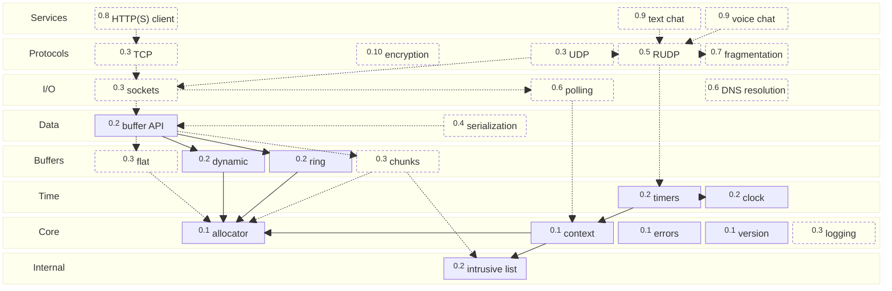

<div align="center">

# VMNL / Network

**Networking library in C**

TCP, UDP, reliable UDP (RUDP) and socket polling for games and real-time applications.

<br>


<br>

[](https://github.com/VMNL/vmnl-net/actions/workflows/ci.yml)
[](https://github.com/VMNL/vmnl-net/blob/main/LICENSE)


</div>

---

> [!WARNING]
> **Work in progress.** Anything can change without notice until `1.0.0`, use it at your own risk.

## Table of Contents

- [Overview](#overview)
- [Architecture](#architecture)
- [Installation](#installation)
- [Technical Documentation](#technical-documentation)
- [Roadmap](#roadmap)
- [References](#references)
- [Author](#author)
- [License](#license)

## Overview

`vmnl_net` is a cross-platform networking library written in C11.
It exposes a single non-blocking API over the native socket interfaces of Windows, macOS and Linux, and builds higher-level protocols and services on top of it.
It is developed as the networking module of the [VMNL](https://github.com/VMNL/vmnl) project and can be used on its own from any C or C++ application.

Feature highlights:

- TCP, UDP and RUDP, a reliable UDP protocol with connections and channels
- Native readiness polling: WSAPoll on Windows, kqueue on macOS and BSD, epoll on Linux
- IPv4 and IPv6
- No background threads: the application drives the library from its own loop, and functions are not thread-safe unless stated otherwise
- Explicit resource management: opaque handles, custom allocator per context and logging hooks, error codes reported through an optional last parameter
- An ABI easy to wrap from other languages: opaque handles and fixed-size integer types, the same on every platform

## Architecture

The library is built in layers, each module pointing to the ones it uses.
In the diagram, solid lines show what exists and dotted ones what is planned.

Every module reports its failures with errors, so those arrows are left out.



## Installation

### From GitHub releases

Each release ships with two prebuilt archives, static and shared libraries, for Windows x86_64, macOS arm64 and Linux x86_64.
Both contain the headers, the CMake package and the pkg-config file, and can be downloaded from the [releases page](https://github.com/VMNL/vmnl-net/releases).

Extract the archive with `tar`, which ships with Windows, macOS and Linux:

```sh
tar -xzf vmnl_net-v0.2.0-linux-x86_64-static.tar.gz
```

It creates a folder named after the archive, with `include/` and `lib/`, plus `bin/` for the Windows DLL.
Move it wherever you keep your dependencies, for example a `third_party` folder in your project: it is the prefix used in [Using the library](#using-the-library).

### From sources

You need CMake 3.28 or later (`cmake --version`) and one of these compilers, the first versions with C11 support:

- GCC 4.9 or later
- Clang 3.3 or later
- Apple Clang from Xcode 5.0 or later
- MSVC from Visual Studio 2019 version 16.8 or later, with the Windows SDK 10.0.20348.0 or later

> [!NOTE]
> Their support is theoretical: the CI only builds and tests with the compilers of the latest GitHub runners.

Then clone, build, test and install it:

```sh
git clone https://github.com/VMNL/vmnl-net.git
cd vmnl-net
cmake --workflow --preset release-static
cmake --install build/release-static --config Release --prefix <prefix>
```

`release-static` builds the static library in Release and runs its tests, and `release-shared` does the same with the shared library.
Added to another CMake project with `add_subdirectory` or `FetchContent`, the library generates no install rules unless `VMNL_NET_INSTALL` is `ON`.
The other presets, for the tests in Debug, the sanitizers, the coverage and the documentation, are listed in [CONTRIBUTING.md](https://github.com/VMNL/vmnl-net/blob/main/CONTRIBUTING.md).

### Using the library

The prefix is the extracted archive folder, or the `--prefix` given to `cmake --install`.

With CMake, pass it to `CMAKE_PREFIX_PATH` when configuring your project:

```sh
cmake -B build -DCMAKE_PREFIX_PATH=<prefix>
```

Then link the library in your `CMakeLists.txt`:

```cmake
find_package(vmnl_net 0.2 REQUIRED)
target_link_libraries(my_app PRIVATE vmnl::net)
```

Without CMake, pkg-config finds it as `vmnl-net`:

```sh
export PKG_CONFIG_PATH=<prefix>/lib/pkgconfig
cc main.c $(pkg-config --cflags --libs vmnl-net) -o main
```

With the shared library, the program must find it at run time: copy `bin/vmnl_net.dll` next to the executable on Windows, or add `-Wl,-rpath,<prefix>/lib` on macOS and Linux.

Include `<vmnl/net.h>` to get the whole API, which is described in the [API reference](https://vmnl.github.io/vmnl-net/topics.html).

## Technical Documentation

The CI generates the API reference with Doxygen from the public headers and publishes it on [GitHub Pages](https://vmnl.github.io/vmnl-net/).

## Roadmap

Each version keeps its target month, and gets its release date once it is implemented, documented and tested on Windows, macOS and Linux.

| Version | Content | Target | Release |
| --- | --- | --- | --- |
| `0.1.0` | Build system, CI and packaging; core: library context, error codes and custom allocator | October 2026 | October 4, 2026 |
| `0.2.0` | Dynamic and ring byte buffers; monotonic clock and application-driven timers | November 2026 | October 11, 2026 |
| `0.3.0` | Non-blocking socket wrapper over Winsock2 and BSD sockets, TCP and UDP sockets; logging hooks | December 2026 |  |
| `0.4.0` | Serialization: bit packing, fixed-size and variable-length integers, with bounds checking | January 2027 |  |
| `0.5.0` | Reliable UDP: connections, sequenced unreliable channels, ordered reliable channels with acknowledgments and retransmission, round-trip time and packet loss statistics | March 2027 |  |
| `0.6.0` | Polling for many sockets with WSAPoll, kqueue or epoll and DNS resolution to IPv4 and IPv6; the last `0.6.x` is the beta | April 2027 |  |
| `0.7.0` | Fragmentation of reliable messages larger than the path MTU | June 2027 |  |
| `0.8.0` | HTTP/1.1 client ([RFC 9112](https://www.rfc-editor.org/rfc/rfc9112)) and HTTPS | October 2027 |  |
| `0.9.0` | Text chat over reliable channels and voice chat over unreliable channels | November 2027 |  |
| `0.10.0` | Encrypted traffic between clients and servers | December 2027 |  |
| `1.0.0` | First stable release, with a stable C ABI | February 2028 |  |

## References

The papers and articles the library is built on, in roadmap order.
Most of them describe old and proven designs, so about once a month I check what changed around them: a new system API, the same design done in another language, or a flaw found in a similar library.
When a source changes a decision, the issue of that decision cites it.

### Buffers (0.2.0)

- [Dynamic buffer requirements](https://www.boost.org/doc/libs/latest/doc/html/boost_asio/reference/DynamicBuffer_v1.html) of Boost.Asio and [Networking TS changes to enable better DynamicBuffer composition](https://open-std.org/jtc1/sc22/WG21/docs/papers/2020/p1790r1.html) by Christopher Kohlhoff (WG21, 2020): the prepare, commit, data and consume model, the offset reads of its version 2, and the copy problem behind it, which a C handle does not have.
- [ByteBuf](https://netty.io/4.1/api/io/netty/buffer/ByteBuf.html) of Netty: the same model in Java, with reader and writer indices, and an explicit compaction that the library does in prepare().
- [The Growth Factor Debate: 1.5x, 2x, or Something Else?](https://pablogs.dev/posts/growth-factor-dynamic-array-1.5-vs-2/) by pablo (2026): why the dynamic buffer grows by 1.5 rather than 2.

### Timers (0.2.0)

- [Hashed and Hierarchical Timing Wheels](http://www.cs.columbia.edu/~nahum/w6998/papers/sosp87-timing-wheels.pdf) by George Varghese and Tony Lauck (SOSP, 1987): the timer wheels I compare with the sorted list and the heap.
- [Reinventing the timer wheel](https://lwn.net/Articles/646950/) by Jonathan Corbet (LWN, 2015): how Linux removed the cascading from its timer wheel, trading accuracy for timeouts that are almost always canceled before they expire.

### Sockets (0.3.0)

- [Beej's Guide to Network Programming](https://beej.us/guide/bgnet/) by Brian Hall: my starting point for sockets, DNS resolution and polling.
- [RFC 768](https://www.rfc-editor.org/rfc/rfc768) and [RFC 9293](https://www.rfc-editor.org/rfc/rfc9293): the UDP and TCP specifications the sockets follow.

### Serialization (0.4.0)

- [Reading and Writing Packets](https://gafferongames.com/post/reading_and_writing_packets/) and [Serialization Strategies](https://gafferongames.com/post/serialization_strategies/) by Glenn Fiedler (Gaffer On Games): bit packing, and the bounds checks that reject malicious packets.

### Reliable UDP (0.5.0)

- [Game networking articles](https://gafferongames.com/categories/game-networking/) by Glenn Fiedler (Gaffer On Games): my main source on UDP, for connections, acknowledgments, round-trip time and packet loss.
- [Quake 3 Source Code Review: Network Model](https://fabiensanglard.net/quake3/network.php) by Fabien Sanglard: how a shipped game sends its snapshots over UDP, with delta compression.
- [RFC 9002](https://www.rfc-editor.org/rfc/rfc9002): loss detection and congestion control in QUIC, the reference for retransmissions.

### Polling and DNS (0.6.0)

- [WSAPoll](https://learn.microsoft.com/en-us/windows/win32/api/winsock2/nf-winsock2-wsapoll), [kqueue(2)](https://man.freebsd.org/cgi/man.cgi?query=kqueue) and [epoll(7)](https://man7.org/linux/man-pages/man7/epoll.7.html): the exact behavior of each polling API.
- [Ringing in a new asynchronous I/O API](https://lwn.net/Articles/776703/) by Jonathan Corbet (LWN, 2019) and [On the way to io_uring networking](https://www.youtube.com/watch?v=O0NMUvThafI) by Pavel Begunkov (Kernel Recipes, 2023): io_uring, the completion model of Linux, which questions the readiness model of the library.

### Fragmentation (0.7.0)

- [Packet Fragmentation and Reassembly](https://gafferongames.com/post/packet_fragmentation_and_reassembly/) by Glenn Fiedler (Gaffer On Games): fragment headers, a conservative MTU of 1200 bytes, and the checks against malicious fragments.

### HTTP (0.8.0)

- [RFC 9112](https://www.rfc-editor.org/rfc/rfc9112): the HTTP/1.1 specification the HTTP client follows.

## Author

[Laszlo Serdet](https://github.com/lszsrd), networking lead of VMNL.

## License

Released under the [MIT License](https://github.com/VMNL/vmnl-net/blob/main/LICENSE).
