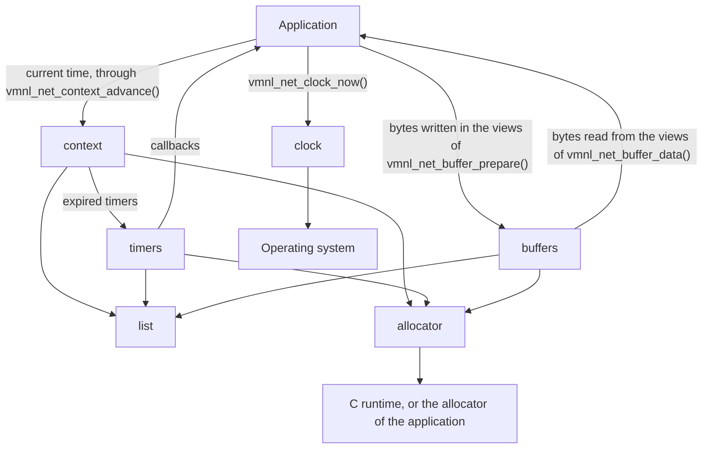
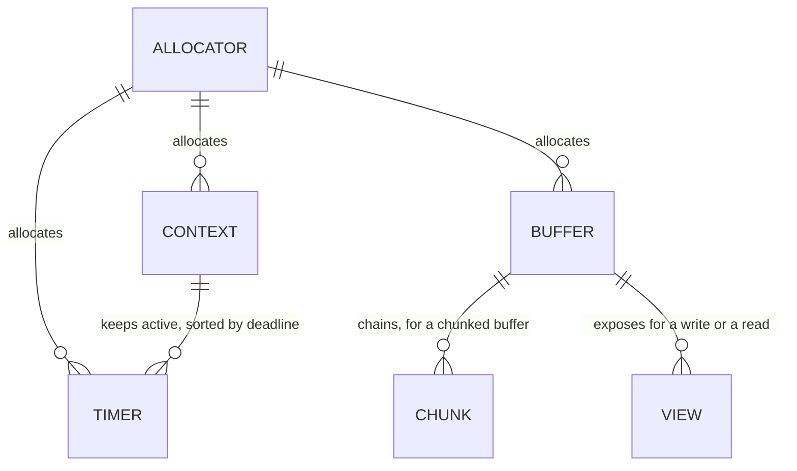

# Architecture

vmnl-net is a C11 library linked into the application, statically or as a shared library.
It runs no service and no thread of its own: every function runs inside a call of the application, on the thread that owns the context.

## Components

| Module | Responsibility | Since | Uses |
| --- | --- | --- | --- |
| allocator | One global allocator, replaceable by the application, `malloc`, `realloc` and `free` by default | 0.1 | C runtime |
| errors | The error codes every function reports, and their messages | 0.1 | |
| version | The version of the library linked at run time | 0.1 | |
| context | The state of one thread: its active timers, and the time given to its last advance | 0.1 | allocator, clock, timers, list |
| clock | A monotonic clock in nanoseconds | 0.2 | `clock_gettime()` on POSIX, `QueryPerformanceCounter()` on Windows |
| timers | One-shot and periodic timers, fired by the time the application gives to its context | 0.2, reworked in 0.3 | context, allocator, list |
| buffers | Byte queues written and read in place, as flat, ring, dynamic or chunked buffers behind one API | 0.2 and 0.3 | allocator, list |
| list | A generic intrusive doubly linked list, internal to the library | 0.2 | |

The planned modules follow the [roadmap](../README.md#roadmap): the sockets, TCP and UDP in 0.3, the serialization in 0.4, RUDP in 0.5, the polling and the DNS resolution in 0.6, the fragmentation in 0.7, the HTTP client in 0.8, the chat in 0.9 and the encryption in 0.10.

## Dependencies and data flows

The bytes never go through a copy of the library: the application writes into the free space a buffer exposes and reads its stored bytes in place.
The time only flows from the application to the context, so the timers never read the clock on their own.

## External dependencies

| Dependency | Used for | When |
| --- | --- | --- |
| C runtime | memory, through the default allocator | run time |
| `clock_gettime()`, `QueryPerformanceCounter()` | the clock | run time |
| Winsock2 (`ws2_32`) and BSD sockets | the sockets, from 0.3 | run time |
| CMake 3.28 | the build, the presets and the packages | build |
| utest.h, Google Benchmark | the tests and the benchmarks, fetched by CMake | development only |
| Doxygen, clang-format, gcovr | the documentation, the formatting and the coverage | development only |

The DNS resolution and the TLS library of the later versions are still to choose, as logged in the [research log](watch.md).

## Deployment

The library ships as static and shared archives for Windows, macOS and Linux on x86_64 and arm64, with a CMake package and a pkg-config file, or is built from its sources, by `FetchContent` for instance.
It lives in the process of the application, which owns the loop: a context belongs to one thread at a time, and the allocator is global to the process.

## Points of failure

| Situation | What the library does |
| --- | --- |
| An allocation fails | The function reports `VMNL_NET_ENOMEM` |
| A flat or ring buffer lacks free space | `vmnl_net_buffer_prepare()` reports `VMNL_NET_ENOBUFS`, while a dynamic buffer grows by 1.5 times and a chunked buffer adds a chunk of 16 KiB without moving its bytes |
| The application stops calling `vmnl_net_context_advance()` | The timers fire late, each callback learns how late it is called, and a periodic timer that missed several deadlines fires once |
| The number of active timers doubles | Starting a timer can walk the whole sorted list, so its worst cost doubles, while equal timeouts still insert at once from the back |
| Two threads use one context | A data race, as the context has no lock, which its documentation forbids |
| The allocator is replaced while objects are alive or other threads run | Memory freed by the wrong allocator or a data race, which its documentation forbids |

## Structuring choices

| Choice | Alternative set aside | Reason |
| --- | --- | --- |
| No background thread | Threads inside the library | It takes no lock, has no data race, and a bug reproduces under a debugger, at the cost of a loop run by the application and of one context per thread |
| Opaque handles and fixed-size integers in the C ABI | Public structures the application embeds | The ABI stays stable, the library is easy to bind from Rust, C# or Python, and the library owns every byte it exposes, at the cost of an allocation per object |
| One global replaceable allocator | An allocator given to each call or each context | No signature carries an allocator, at the cost of a contract on when and from which thread it is replaced |
| One buffer API over operation tables | One API per kind of buffer | The application changes the kind of a buffer without changing its code |
| Timers in a sorted intrusive list | A heap or a timer wheel | The naive list stays until the benchmarks show the need for another structure |
| Typed socket families sharing a base, planned for 0.3 | A generic socket, or a flat list of typed sockets | Invalid combinations do not compile, and a new family reuses the base, as compared in the [research log](watch.md) |

## Data model

| Entity | Lifetime | Size |
| --- | --- | --- |
| allocator | the process | 3 function pointers |
| context | created and destroyed by the application, one per thread | its active timers and the time of its last advance |
| timer | created by the application, started in a context | one link, a callback and its data, a deadline and an interval |
| buffer | created and destroyed by the application | its capacity, fixed for flat and ring buffers |
| chunk | owned by a chunked buffer | 16 KiB of bytes |
| view | given by the buffer for a write or a read, invalid once the buffer is destroyed | a pointer and a size |

The expected numbers of timers and buffers per context will be measured once the sockets exist.
