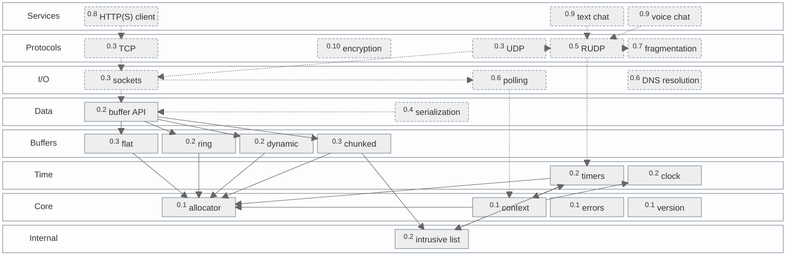
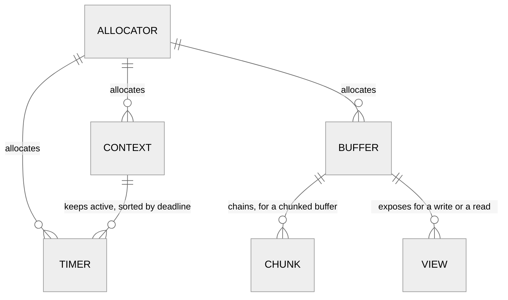

# Architecture

vmnl-net is a C11 library linked into the application, statically or as a shared library.
It runs no service and no thread of its own. Every function runs inside an application call, on the thread that owns the context.

## Layers

The library is built in layers, each module pointing to the ones it uses.
In the diagram, solid lines show what exists and dotted ones what is planned.

Every module reports its failures with errors, so those arrows are left out.
RUDP is a connection over UDP with reliable and unreliable channels.
Text chat uses the reliable ones, voice chat the unreliable ones, without retransmission.

The application gives the time to its context, so the timers never read the clock themselves.
The bytes never go through a library copy on their way in or out. The application writes into the free space a buffer exposes and reads the stored bytes in place.

## Modules

### allocator

> 0.1

- Uses: the C runtime

One global allocator, replaceable by the application, with `malloc`, `realloc` and `free` by default.

### errors

> 0.1

The error codes every function reports, and their messages.

### version

> 0.1

The version of the library linked at run time.

### context

> 0.1

- Uses: allocator, clock, timers, list

The state of one thread, with its active timers and the time given to its last advance.

### clock

> 0.2

- Uses: `clock_gettime()` on POSIX, `QueryPerformanceCounter()` on Windows

A monotonic clock in nanoseconds.

### list

> 0.2

An internal generic intrusive doubly linked list.

### timers

> 0.2, reworked in 0.3

- Uses: context, allocator, list

One-shot and periodic timers, fired by the time the application gives to its context.

### buffers

> 0.2 and 0.3

- Uses: allocator, list

Byte queues written and read in place, as flat, ring, dynamic or chunked buffers behind one API.

The planned modules follow the [roadmap](../README.md#roadmap) and appear dotted in the diagram.

## Dependencies

The library has no third-party dependency. It only needs the C runtime and the system sockets, Winsock2 on Windows and BSD sockets elsewhere.
The first ones may come with the DNS resolution of 0.6 and the TLS library of 0.8, like c-ares or OpenSSL, still to choose in decisions [0005](https://github.com/VMNL/vmnl-net/blob/main/docs/decisions/0005-dns-resolution.md) and [0006](https://github.com/VMNL/vmnl-net/blob/main/docs/decisions/0006-tls-library.md).
The build and development tools are listed in [docs/build.md](build.md).

## Deployment

The library ships as static and shared archives for Windows, macOS and Linux on x86_64 and arm64, with a CMake package and a pkg-config file.
It can also be built from its sources, with `FetchContent` for instance.
It lives in the application's process, and the application owns the loop. A context belongs to one thread at a time, and the allocator is global to the process.

## Points of failure

### An allocation fails

The function reports `VMNL_NET_ENOMEM`.

### A buffer lacks free space

A flat or ring buffer makes `vmnl_net_buffer_prepare()` report `VMNL_NET_ENOBUFS`.
A dynamic buffer grows by 1.5 times, and a chunked buffer adds a 16 KiB chunk without moving its bytes.

### The application falls behind

The timers fire late, and each callback learns how late it runs.
A periodic timer that missed several deadlines fires once.

### The number of active timers grows

Starting a timer can walk the whole sorted list of [decision 0011](https://github.com/VMNL/vmnl-net/blob/main/docs/decisions/0011-sorted-list-of-timers.md), so its worst cost grows with the number of active timers, while equal timeouts still insert at once from the back.
On the reference machine, a start costs 3.3 ns with deadlines in order, and 19 to 21 µs out of order with 32,000 active timers in a new process, up to 26 µs after repeated runs in the same process.

### Two threads use one context

A data race, since the context has no lock. Its documentation forbids it.

### The allocator is replaced while objects are alive or other threads run

Memory freed by the wrong allocator, or a data race. Its documentation forbids it.

## Structuring choices

- [0001 Socket model](https://github.com/VMNL/vmnl-net/blob/main/docs/decisions/0001-socket-model.md)
- [0002 Cryptography](https://github.com/VMNL/vmnl-net/blob/main/docs/decisions/0002-cryptography.md)
- [0005 DNS resolution](https://github.com/VMNL/vmnl-net/blob/main/docs/decisions/0005-dns-resolution.md), proposed
- [0006 TLS library](https://github.com/VMNL/vmnl-net/blob/main/docs/decisions/0006-tls-library.md), proposed
- [0007 No background thread](https://github.com/VMNL/vmnl-net/blob/main/docs/decisions/0007-no-background-thread.md)
- [0008 Opaque handles](https://github.com/VMNL/vmnl-net/blob/main/docs/decisions/0008-opaque-handles.md)
- [0009 Global allocator](https://github.com/VMNL/vmnl-net/blob/main/docs/decisions/0009-global-allocator.md)
- [0010 Buffer operation tables](https://github.com/VMNL/vmnl-net/blob/main/docs/decisions/0010-buffer-operation-tables.md)
- [0011 Sorted list of timers](https://github.com/VMNL/vmnl-net/blob/main/docs/decisions/0011-sorted-list-of-timers.md)
- [0012 Timer structure](https://github.com/VMNL/vmnl-net/blob/main/docs/decisions/0012-timer-structure.md), proposed
- [0014 Polling](https://github.com/VMNL/vmnl-net/blob/main/docs/decisions/0014-polling.md), proposed
- [0015 Buffer view layout](https://github.com/VMNL/vmnl-net/blob/main/docs/decisions/0015-buffer-view-layout.md)
- [0016 Winsock startup](https://github.com/VMNL/vmnl-net/blob/main/docs/decisions/0016-winsock-startup.md)
- [0017 System socket](https://github.com/VMNL/vmnl-net/blob/main/docs/decisions/0017-system-socket.md)
- [0018 Sends and receives](https://github.com/VMNL/vmnl-net/blob/main/docs/decisions/0018-sends-and-receives.md)
- [0019 ICMP errors on Windows](https://github.com/VMNL/vmnl-net/blob/main/docs/decisions/0019-icmp-errors-on-windows.md)

## Data model

- allocator, alive for the whole process, made of 3 function pointers
- context, created and destroyed by the application, one per thread, holding its active timers and the time of its last advance
- timer, created by the application and started in a context, holding one link, a callback and its data, a deadline and an interval
- buffer, created and destroyed by the application, with a capacity fixed for flat and ring buffers
- chunk, owned by a chunked buffer, holding 16 KiB of bytes
- view, given by a buffer for a write or a read and invalid once the buffer is destroyed, made of a pointer and a size

The expected numbers of timers and buffers per context will be measured once the sockets exist.
