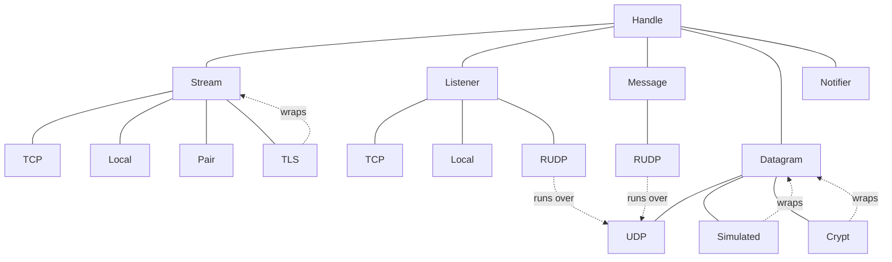

# 0001 Socket model

- Date: November 19, 2026
- Status: accepted, to be implemented in 0.3.0

**Context and problem**

The library needs public TCP and UDP sockets over Winsock2 and BSD sockets in 0.3.0, then RUDP, local sockets, and decorators like TLS or a simulated network.
A first draft exposed one generic socket, which let invalid combinations compile, like `listen()` on UDP or a broadcast on TCP.
A second draft gave each kind of socket its own type. It repeated the same functions for each kind and could not grow to new families.

**Options considered**

1. A generic socket with a base address, like BSD sockets, ENet, socket2 or .NET.
2. Typed sockets with an address per family, like Rust's standard library, SDL_net or Asio.
3. Typed families sharing a base, like libuv or Go.

The comparison and its sources are in the [research log](../watch.md).

**Option chosen**

Option 3. A Handle base covers destruction, polling and the native handle, under the families Stream, Listener, Message, Datagram and Notifier.
Each kind of socket implements its family's operations through a table, like the buffers, and takes its options through setters.

The diagram shows the families and their planned kinds. A solid line goes from a family to its kinds, and a dotted one from a kind to what it runs over or wraps.

**Reason**

Invalid combinations do not compile, a new family or kind reuses the base, and operation tables already work for the buffers.

**Consequences accepted**

- Options are setters, so creating a socket and binding or connecting it stay separate calls. Setters that only work before a bind document that contract.
- Kinds without a system socket, like RUDP, an in-memory pair or a decorator, cannot use the system socket setters.
- Each socket costs an allocation behind its opaque handle.
- Kinds that behave differently on Windows, macOS and Linux stay out of the public API. Windows refuses local datagrams with `WSAEAFNOSUPPORT`, only Linux has local `SOCK_SEQPACKET`, and `WSAPoll` cannot wait on pipes.
