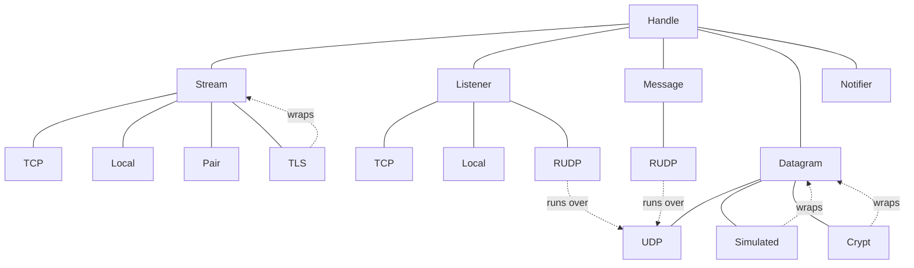

# 0001 Socket model

- Date: 2026-11-19
- Status: accepted, to be implemented in 0.3.0

**Context and problem**

The library needs public sockets over Winsock2 and BSD sockets for TCP and UDP in 0.3.0, then RUDP, local sockets, and decorators such as TLS or a simulated network.
A first draft exposed one generic socket, which let invalid combinations compile, like `listen()` on UDP or a broadcast on TCP.
A second draft gave each kind of socket its own type, which repeated the same functions for each kind and could not grow to new families.

**Options considered**

1. A generic socket with a base address, like the BSD sockets, ENet, socket2 or .NET.
2. Typed sockets with an address per family, like the standard library of Rust, SDL_net or Asio.
3. Typed families sharing a base, like libuv or Go.

The comparison and its sources are in the [research log](../watch.md).

**Option chosen**

Option 3: a Handle base for the destruction, the poll and the native handle, with the families Stream, Listener, Message, Datagram and Notifier.
Each kind of socket implements the operations of its family through a table, like the buffers, and takes its options through setters.

The families and the kinds planned for them, with a solid line from a family to its kinds, and a dotted one from a kind to what it runs over or wraps:

**Reason**

Invalid combinations do not compile, a new family or a new kind reuses the base, and the operation tables already work for the buffers.

**Consequences accepted**

- The options are setters, so creating a socket and binding or connecting it stay separate calls, and the setters that only work before a bind carry that contract in their documentation.
- The kinds without a socket of the system, like RUDP, an in-memory pair or a decorator, cannot use the setters of the system sockets.
- Each socket costs an allocation, behind its opaque handle.
